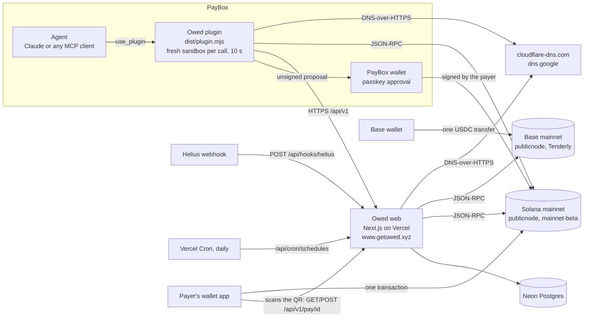

# Architecture

Owed is a PayBox plugin plus a small web service. The plugin is what an agent calls; the web service stores requests, serves the pages people pay from, and checks Solana (and Base, for Base requests) for payments. Neither one holds money: every payment is a single transaction from the payer's wallet to the recipient.



## The plugin (`plugin/`)

- A TypeScript MCP server over stdio, built from the PayBox plugin starter v1.0.2 and bundled with esbuild to one ESM file, `plugin/dist/plugin.mjs`. Two builds must be byte-identical (`pnpm test`), so nothing reads the clock or randomness at module load.
- PayBox starts a fresh process for every call and gives it 10 seconds. There is no network at startup or during tool discovery. During a call it may reach only the hosts configured in the portal, over HTTPS: the Owed host, two Solana RPC hosts and two DNS-over-HTTPS hosts. There are no secrets: the only variable is `OWED_BASE_URL`, which isn't secret.
- Budgets inside the 10 s: the Owed API gets 4 s per call (7 s for `what_do_i_owe`'s inbox call, because the server checks open requests on chain before it answers); Solana reads get 5.5 s, with 3 s per RPC host before falling through to the next; DNS gets 2.5 s per resolver. `pay_link` runs its DNS check alongside the balance check. When a payment is short, `pay_link` / `pay_all` read Pyth's price (≤ 1.5 s) and record the plan with Owed (≤ 2 s, best effort: without an answer the plan goes out without a `plan_id`); the call that ends a plan tells Owed (≤ 1.5 s).
- Twenty-one tools: `ask_for_money`, `check_payments`, `pay_link`, `verify_payee`, `split_bill`, `create_invoice`, `who_owes_me`, `write_reminder`, `ask_every_month`, `cancel_request`, `match_payments` (0012: payments without the reference, matched by the recipient), `what_do_i_owe` (0017: the payer's signed inbox), `pay_all` (0017: several requests, one transaction), `start_ledger`, `add_expense`, `ledger_balances`, `settle_up` (0020: group ledgers), `refund_payment` (0021: refunds), `start_pot` (0019: chip-in pots), `set_autopay` (0022: autopay rules) and `cash_out` (0024: cash-out through MoonPay, off until its keys are set). The portal build submitted at cecfbd2 has the first eleven as they were then; the remote MCP endpoint (`POST /api/mcp`, below) runs the current bundle with all twenty-one (and the funding plans, pots in `pay_link`, invoice terms, reminders, statements and refunds added to the first eleven), and the portal gets the rest with its next upload. Tools that move money return a PayBox proposal (`io.paybox/transactionProposal`). The plugin never signs; the user approves in PayBox with a passkey.
- If the Owed API is unreachable, `ask_for_money` still returns a working Solana Pay link (shown on the stateless `/p` page), and `check_payments` checks raw Solana Pay links directly on chain. Asks that need the server (a local currency, a Base request) refuse instead and say why.
- SNS names (`plugin/src/sns.ts`) are resolved over the same Solana RPC hosts, so they add no host to the portal's allowlist. So is the SOL/USD price a funding plan uses: Pyth's on-chain account `7UVimffxr9ow1uXYxsr4LHAcV58mLzhmwaeKvJ1pjLiE`, with its feed id and owner program checked (`plugin/src/funding.ts`).

## The web service (`web/`)

- Next.js 16 on Vercel, Node runtime for every route. JSON API at `/api/v1`: create and read requests, groups and invoices; batch status (`POST /status`, up to 20 ids); status for a raw Solana Pay link (`POST /status-raw`); stats; the signed ledger behind `who_owes_me` (`POST /ledger`, `GET /ledger/csv` for a 10-minute CSV link); monthly schedules (`POST /schedules`); a recipient-signed cancel (`POST /requests/<id>/cancel`); a payment matched by the recipient (`POST /requests/<id>/match`, signed, re-verified on chain), the rest of an underpaid request (`POST /requests/<id>/rest`) and what is already counted (`POST /attributed`); the payer inbox behind `what_do_i_owe` (`POST /inbox` and `POST /inbox/block`, both signed by the payer's wallet); the bulk read `pay_all` uses (`GET /requests?ids=`, 1 to 20 ids, each in the shape `GET /requests/<id>` returns, unknown ids listed apart); and the Solana Pay transaction request the QR encodes (`GET`/`POST /pay/<id>`); and the pay page's Pay with PayBox counters (`GET /cta/paybox?r=<id>`, a counted 302 to app.paybox.sh; `POST /cta` for prompt copies); funding plans (`POST /plans`, a plan offered, 30 an hour per sender; `POST /plans/<id>/used`, only the plan's sender; `GET /plans/stats`); group ledgers (`POST /ledgers`, `GET /ledgers/<id>` with `?chain=0` to skip the chain check, `POST /ledgers/<id>/expenses` and `POST /ledgers/<id>/settle`, both signed); invoice terms on `POST /invoices` and `GET /invoices/<id>` (terms, the invoice a request belongs to, refunds, `superseded_by`); refunds (`POST /refunds`, signed; `GET /refunds?requests=` and `GET /refunds/<id>`); and a client's monthly statement (`GET /statements` with the signed ledger message, `GET /statements/csv` for its 10-minute link); chip-in pots (`POST /pots`, `GET /pots/<id>`, `POST /pots/<id>/contributions`, and `POST /pay/<pot id>?amount=` minting one contribution per scan); autopay rules (`POST /autopay` and `POST /autopay/revoke`, both signed by the payer; verdicts ride on `POST /inbox`); paid alerts (`POST /alerts`, `POST /alerts/confirm`, `POST /alerts/unsubscribe`); cash-out (`POST /cash-out`, `GET /cash-out/<id>`, `POST /cash-out/accounts`) and bank details (`POST /virtual-accounts`), each refused while its flag is off. Errors are always `{error:{code,message}}`.
- Outside `/api/v1`: `/api/hooks/helius` (Helius webhook), `/api/cron/schedules` (Vercel Cron, daily at 00:07 UTC: monthly schedules, then invoice terms: later installments, full prices, late fees and pending refunds, then paid alerts still due), `/api/qr/<id>.png`, `/x/pot/<pot id>/<amount>` (a pot's x402 presets), `/api/hooks/telegram` (the alerts bot, 404 until it is configured), and, only when MoonPay is configured, `/api/moonpay/<id>`, `/api/hooks/moonpay` (card and, with `OWED_MOONPAY_SELL=1`, sell events) and, only with `OWED_BANK_RAIL=1`, `/api/hooks/moonpay-enterprise`.
- Pages: `/r/<id>` (pay page: QR, wallet button, live status, receipt, and, while open and when `OWED_PAYBOX_CTA=1`, "New to crypto? Pay with PayBox"), `/g/<id>` (split board), `/i/<id>` (printable invoice: with terms, the installment plan, both prices, the late fee, refunds and a "due now" pay panel), `/i/statement` (a client's monthly statement, from a 10-minute signed link), `/l/<id>` (group ledger: balances, settle-up requests polled live, expenses with their signed messages), `/pot/<id>` (chip-in pot board: total against target, contributions, printable transaction-request QR codes, a per-click payment link), `/alerts` (paid alerts sign-up, with `/alerts/confirm` and `/alerts/unsubscribe`), `/cash-out/<id>` (where MoonPay sends a seller back), `/x/<id>` (x402 endpoint), `/p?u=<solana: URL>` (stateless page), `/proof` (the team's own payments on every rail, and what Owed refuses), the landing page and `llms.txt`.
- Storage: Neon Postgres, reached over its SQL-over-HTTP endpoint. Production and previews use separate databases, so previews and smoke runs never write production rows. Schema changes are numbered files in `web/db/migrations/`. The Vercel build applies them: `pnpm build` runs `web/scripts/migrate-on-build.mjs` before `next build`, for Production and Preview builds only, against that environment's database (`DATABASE_URL_UNPOOLED`, else `DATABASE_URL` with a Neon pooler host swapped for the direct one). It holds a Postgres advisory lock for the run (key `0x6f776564`, "owed"; it waits at most 300 s for another build), and applies each file not yet in `schema_migrations` in its own transaction together with its `schema_migrations` row, in file-name order. A failed migration is rolled back, the build fails and the previous deployment keeps serving. The new schema goes live before the new code does, while the old deployment still serves, so every migration must work with the code already deployed (add columns and tables; don't rename or drop in the same release). `web/scripts/migrate.sh` (psql) shares the same table and still works by hand.
- Requester text (names, "for", notes, invoice lines) is cleaned on the way in: links and invisible characters stripped, double quotes replaced, length capped. Pages show it in quotes, labelled as written by the requester, and isolated for right-to-left scripts. A brand word in the text, or in a verified domain, adds a caution banner. X handles (the payer's and the requester's own) are checked for format only (1 to 15 letters, digits or `_`), stored lower case without `@`, and shown as not verified by Owed; a brand word in the requester's handle adds the same caution. Creation is rate-limited per recipient and globally; a request addressed to a payer also counts against 30 an hour per requester wallet and 10 an hour per requester and payer.
- `POST /api/mcp` (`app/api/mcp/route.ts`, `lib/mcp/*`): Owed as a remote MCP server. It answers `initialize`, `ping` and `server/discover` itself, serves the bundle's own `tools/list` (one process per warm instance, then cached) and runs every `tools/call` in a fresh process of `web/mcp/owed-plugin.mjs` (decision D4), the way PayBox's sandbox does: one stateless 2026-07-28 request, clean environment (`OWED_BASE_URL` from `OWED_MCP_BASE_URL`, default `https://www.getowed.xyz`), 10 s, 256 KiB, process group killed after the answer, at most 8 processes per instance.

## A request's life

1. **Create.** The server picks a random 32-byte reference and derives the request id from the terms: the last 12 base58 characters of `sha256("owed-request:v1", recipient, asset, atomic amount, reference)` (`web/lib/ids.ts`, `plugin/src/request-id.ts`). The Solana Pay URL carries the recipient, amount, USDC mint (for USDC), the reference and the memo `owed:<id>`. `ask_for_money` refuses a hosted link whose id doesn't hash its terms.
2. **Pay.** A wallet scans the QR, which is a Solana Pay transaction request (`solana:https://www.getowed.xyz/api/v1/pay/<id>`, `web/lib/pay-tx.ts`): the wallet sends its address, Owed builds the transaction (the same layout as below, with the reference and memo inside) and the wallet only signs it. Phantom's scanner turns a scanned *transfer* URL into a plain send that drops the reference, which is why the QR doesn't encode one; the transfer URL is still returned to agents and shown as a link.    Or `pay_link` resolves the link, checks the request is open and the sender can cover the amount plus about 0.003 SOL for fees, and builds one legacy transaction: the recipient's USDC account if it's missing (created idempotently), the memo, and `transferChecked` (USDC) or a system transfer (SOL), with the reference as a read-only key. The size limit is 1,232 bytes.
   **Short?** `pay_link` and `pay_all` return a funding plan instead of a proposal (`plugin/src/funding.ts`): the shortfall, what the wallet holds, and ordered options with exact PayBox arguments (`request_swap` SOL→USDC sized at Pyth's price minus its confidence band plus 1%; a Base→Solana `request_swap` to the sender's own wallet after `get_portfolio`; a swap from another token the user picks; `get_buy_link` `usdc_sol` for the shortfall rounded up to the cent, at least 4.99; or rail x402 when only the fee is short and x402 can pay), each ending with the same call again. It is text plus a ```json `funding_plan`, refusal-shaped (isError), because the tool's output schema is PayBox's proposal envelope. Exact-output swaps aren't used: PayBox's `request_swap` has a `swap_direction` field but documents no exact-output mode.
   Or `pay_all` reads every request's terms in one call (`GET /api/v1/requests?ids=`), runs `pay_link`'s checks on each, and builds one legacy transaction for what passes: per request, the recipient's USDC account if it's missing (created idempotently, once per recipient) and one transfer with that request's references as read-only keys, then one memo `owed:<id> owed:<id> …`. It proposes the longest run that fits in 1,232 bytes (about 6 to 9 payments) and names the rest for the next call.
3. **Check.** A request is paid only by one confirmed, successful transaction that carries its reference and credits the recipient with at least the amount. For USDC that's the net change across the recipient's USDC accounts; for SOL it's lamports. Less is underpaid; credits to anyone else, other mints and failed transactions are ignored. Reads accept version-1 transactions, which mainnet carries. Because a reference is public, the check reads the reference's whole history, drops failed transactions and reads oldest first. Each reference is paired with the transfer instruction that carries it (Solana Pay puts references on the transfer), so a transaction that pays several requests (`pay_all`) settles each with its own transfer, even two to one recipient for one amount; one transfer that names two references settles only one. A reference that rides on another instruction keeps the old rule: the net credit to the recipient, paired with the recipient's only transfer in that transaction, or with the whole transaction when there is more than one. The server writes "paid" once and records which transfer paid (`requests.paid_instruction`; null means the whole transaction, as for Base, x402, MoonPay and matched payments); a unique index on (signature, transfer) stops one transfer from settling two requests. The plugin applies the same rules when it checks a raw link directly.
4. **Settle without anyone looking.** A Helius webhook (`/api/hooks/helius`, shared-secret header) reports transactions that touch Owed references. The route answers at once, then re-checks each referenced request on chain through the normal settle path; the webhook body itself never marks anything paid. Preview deployments don't register a webhook. Status reads (`POST /status`, the pay page) settle the same way, so a request is marked paid whether or not the page is open.

### Other rails and sources

- **Base (USDC, chain 8453).** `ask_for_money` with `chain: "base"` stores a Base recipient (EIP-55 checksummed; a mistyped mixed-case address is refused, never "fixed") and returns an EIP-681 link (`ethereum:<USDC>@8453/transfer?address=<recipient>&uint256=<atomic>`). Base has no reference key, so the server reads USDC `Transfer` logs to the recipient through `base-rpc.publicnode.com` (and Tenderly's gateway for older blocks) and matches every open Base request to that recipient together: exact amount, after the request was made, oldest request first, one transaction per request (`web/lib/evm/`). Each request keeps a cursor, so a check reads only blocks it hasn't seen. `pay_link` never builds a Solana transaction for a Base request; it pays over x402 on `eip155:8453` from the user's PayBox Base wallet. Rail `base_transfer`.
- **Monthly schedules.** `ask_every_month` stores a schedule (`POST /schedules`). A daily Vercel Cron opens that month's request through the normal create path, idempotently per schedule and month, and refuses any call without `CRON_SECRET`. Each month's request is an ordinary request.
- **Matched payments (rail `matched`).** A transfer without the reference counts only through `POST /requests/<id>/match`: the recipient's ed25519 signature over `Owed match <tx> to <id> for <recipient> at <ISO>` (5 minutes, single use), then a chain check that the transaction is confirmed, successful, credits the recipient exactly what is still due, landed after the request, names no Owed reference and isn't counted elsewhere. The signed message is stored as the proof.
- **Group ledgers (0020).** One arithmetic file, byte-identical in `plugin/src/ledger-math.ts` and `web/lib/ledgers-math.ts` (checked by `web/test/ledgers-math.test.ts`): splits (even / shares / exact / items with tax and tip pro rata; leftovers to the first members like `splitEvenly`), balances, and the greedy plan (largest debtor ↔ largest creditor, ties to the earlier member, ≤ n − 1 transfers, sums exact). Writes are signed by a wallet named in the ledger (owner or member): `Owed add expense <digest> (<total> <currency>) to ledger <id> by <signer> at <ISO>`, where the digest is sha256 over the canonical expense (amounts in integer units, member positions, descriptions cleaned by the shared `ledgerText`), so anyone can recompute it from `GET /ledgers/<id>`; and `Owed settle up ledger <id> v<version>: <n> requests, <total> USDC by <signer> at <ISO>`. Both 5 minutes, single use (`signature_nonces`, purposes `ledger_expense` 60/h and `ledger_settle` 30/h). A local-currency expense locks each member's share to USDC at one live rate under the two-source 2% rule, rounded up. A settle-up is one SQL statement: the version moves only from the signed one, then the settlement, the requests (ordinary `kind 'single'` rows, ids derived from their terms like every request) and the links to the ledger are written together. Each settle-up request pays the creditor's wallet and is addressed to the debtor's (it lands in their `what_do_i_owe`); a creditor without a wallet is listed and skipped. Balances read live request statuses: paid = settled, underpaid = what arrived, open = pending, cancelled/expired = owed again (a settle-up refuses to re-ask a cancelled debt unless the chain could be read).
- **Invoice terms (0021).** An invoice's own request asks installment 1 or the early price; every later request (each installment, the full price, the late fee) is a whole invoice of its own, opened by the daily cron from `invoice_term_requests` (installments 7 days before their due date; the full price the day after the early price ends, unless it was paid; the late fee once, the day after the due date, only if not paid on time; each decision reads the chain first and waits a day when Solana can't be read). A Postgres trigger cancels the other price in the same transaction that records a payment (`requests.superseded_by`; `requests_cancel_check` accepts the recipient's signed proof or `superseded_by`). The invoice API and page show the invoice as a whole (`terms`): paid only when every installment is. Chase days are stored with the terms (3, 7 and 14 days after the due date unless the invoice sets others; the default needs no row); the ledger route adds each invoice's days and the reminder due, `who_owes_me` works out the stage itself from the due date and those days (3/7/14 when an older server sends none), and nothing is ever sent. An invoice takes installments or an early discount, not both. Installments are refused in a local currency (each part would round on its own); an early discount and a late fee work in one, each price its own quote at the rate locked at issue.
- **Refunds (0021).** `refund_payment`: the recipient signs `Owed refund <amount> <token> of <id> to <payer> for <recipient> at <ISO>`, the server stores a pending refund with a fresh reference (id from `sha256("owed-refund:v1", …)`), and the plugin proposes one transfer recipient → payer carrying it (memo `owed-refund:<id>`). Confirmed only when the chain shows that transfer from the recipient, one transfer per refund; confirmed plus pending (younger than 30 minutes) never exceeds what was paid, checked under a row lock. Card (MoonPay) and hand-matched payments aren't refunded here: the paying wallet may not be the payer's.
- **Statements.** `GET /api/v1/statements` (the signed ledger message) folds a client's invoices into invoiced / cancelled / expired / paid / refunded lines and opening and closing balances for a month (balance = invoiced − cancelled − paid + refunded; negative is a client credit). CSV and page links are HMAC-signed and last 10 minutes.
- **Chip-in pots (0019).** A pot's id is the last 14 base58 characters of `sha256("owed-pot:v1\n" recipient "\n" asset "\n" nonce)`, so it commits to the wallet and the token and can't collide with a 10- or 12-character request id; `start_pot` and `pay_link` refuse a pot that doesn't hash (decision D15). A contribution is an ordinary `requests` row with `pot_id` (kind `single`, its id hashing its own terms), so every rail, the Helius watch, refunds and `/proof` work on it unchanged. It is minted by one SQL statement that reads the recipient and token from the pot row and checks the deadline with the database clock: per transaction-request scan (`/api/v1/pay/<pot id>?amount=`), per click on the board, per x402 preset payment that passed the local checks and the facilitator's `/verify`, and by `pay_link` right before it proposes (a short wallet's funding plan mints nothing); never on a page render. Every pot ends (default 30 days, at most 90), and a contribution expires at least(deadline, minted + 24 h), so past the deadline every rail refuses; a payment that lands anyway is recorded and counted. The board sums paid and part-paid contributions after settling the 25 newest unsettled ones from the chain (≤ 1.5 s). Open contributions are never listed as debts (`who_owes_me` shows pots apart), and an expired one leaves the Helius watch.
- **Autopay rules (0022).** `set_autopay` stores a rule the payer signs: `Owed autopay for <payer>: pay <requester> up to <max> USDC per request and <max_month> USDC per month until <YYYY-MM-DD> (at <ISO>)`. It matches the requester's wallet only (handles and `.sns` names are labels); one live rule per payer and requester wallet, and a new one retires the old in the same transaction. The signed inbox returns the payer's rules and a verdict per line (`web/lib/autopay-core.ts`): eligible, over_limit or not_covered, where the month cap counts what this payer paid this requester this UTC month since the rule began plus the eligible lines listed before it, and one `getMultipleAccounts` read checks the requesters' USDC accounts (x402 can't open one). `what_do_i_owe` attaches PayBox `pay_x402` calls (accepts copied from the live 402) only after re-checking the payer's signature on the rule, the request's id-checked terms, the sanctions screen and the challenge itself. Owed never pays; whether PayBox runs the call under an autonomous grant without a passkey is untested (D7, D16).
- **Deposit links (0022).** `requests.deposit_url` holds a PayBox Open Deposit URL from the requester's agent (`get_deposit_link`): https on paybox.sh, USDC on Solana, plain invoices only, never part of the id. `/r/<id>` and `/i/<id>` offer it for 24 hours after it was added, only with `OWED_DEPOSIT_LINK=1` (off on production). Owed can't see where it pays, so counting stays chain + `match_payments` (D17).
- **Cash-out (0024, off).** `cash_out`'s first call gets a MoonPay sell-widget URL signed by the server (usdc_sol, the exact amount, refunds to the wallet, the cash-out id as `externalTransactionId`). MoonPay's REST sale documents no deposit address, so the address is written only from a verified `Moonpay-Signature-V2` sell webhook whose currency, amount and refund wallet match, and released only while a fresh REST read of the same sale says `waitingForDeposit` with the same terms. The second call proposes one USDC transfer to it; nothing takes an address as input. The Enterprise route (`OWED_MOONPAY_ENTERPRISE=1`) uses a liquidation address the wallet signed for, re-read from MoonPay and checked against that signature before every release. Flags: `OWED_MOONPAY_SELL`, `OWED_MOONPAY_ENTERPRISE` (D18).
- **Bank transfer (rail `bank_transfer`, 0023, off).** With `OWED_BANK_RAIL=1`, an invoice shows "Pay by bank transfer" to the recipient's own MoonPay virtual account (EUR SEPA; USD ACH/wire/RTP/FedNow; GBP CHAPS/FPS), shown only while the stored details match the recipient's signature. A transfer carries no reference: the Enterprise webhook's amount and time pick the one open invoice in that currency with that amount, and it is marked paid only after the chain shows MoonPay's USDC credit to the recipient; two open invoices sharing an amount get nothing (the recipient uses `match_payments`), less than the only open invoice is underpaid, and the webhook alone marks nothing.
- **Paid alerts (0025).** A trigger on `requests.status` queues one `alert_deliveries` row per active subscription when a request first becomes paid or part paid, in the same transaction, so every rail is covered once; its errors are caught so settling never fails. Every paid write calls `alertsSoon()`, which sends after the response; the daily cron sends what is left. Rows are claimed with `FOR UPDATE SKIP LOCKED` and retried (3 tries a run, 5 in all, 48 h at most). A subscription starts with the wallet's signed `Owed alerts for <wallet> at <ISO>` (5 minutes, once); Telegram links come from a one-time `/start` code (15 minutes), email (off until `RESEND_API_KEY` is set) from a confirm link (24 hours, POST only). Only sha256 hashes of codes and tokens are stored, and unsubscribing scrubs the chat id or address. The bot webhook checks `X-Telegram-Bot-Api-Secret-Token`.
- **Pay by card with MoonPay (rail `moonpay_card`, off by default).** With `NEXT_PUBLIC_OWED_MOONPAY=1` and a matching MoonPay key pair, the pay and invoice pages offer "Pay by card (MoonPay)". `/api/moonpay/<id>` signs MoonPay's widget URL on the server (USDC on Solana, exactly the amount owed, delivered to the recipient, the request id as `externalTransactionId`, bound to the payer's IP) and redirects. MoonPay's delivery is a plain transfer with no reference, so MoonPay's report (signed webhook or its API) only names *which* Solana transaction to look at; Owed marks the request paid only when that transaction credits the recipient on chain (`web/lib/moonpay/attribution.ts`). Sandbox keys label the button "Sandbox"; without keys nothing about MoonPay renders or runs. Production has it off.

## What each part guarantees

- **Non-custodial.** The payer's own wallet sends the money to the recipient in one transaction. Owed has no wallet and adds no fee instruction.
- **The id commits to the payment (Solana Pay rail).** `pay_link` recomputes the id from what `GET /api/v1/requests/<id>` returns, and refuses unless it matches and the server's Solana Pay URL pays exactly those terms. So the server can't change who gets paid or how much behind a link that was already shared: different terms would need a different id. Older random 10-character ids stay readable, but `pay_link` refuses them.
- **x402 rail.** Every request also has an x402 endpoint at `/x/<id>`. With `rail: "x402"`, your agent checks the id and the live x402 challenge against the request before it proposes the payment. PayBox fetches the challenge again when it pays, so "the server can't change who gets paid" is a Solana Pay guarantee only. The first x402 settle on mainnet was request `FeJG9SuofqWU`, 0.01 USDC through PayBox `pay_x402`, with the facilitator as fee payer (docs/FACTS.md).
- **Verified payee.** A requester proves a domain with a DNS TXT record `_owed.<domain>` → `owed-pay=<wallet>` (one record per wallet).
  - The plugin reads that record itself over DNS-over-HTTPS (cloudflare-dns.com, then dns.google). It reports DNSSEC from the resolver's AD flag and warns on internationalized names, mixed scripts, lookalike and digit-for-letter spellings, brand words in the name (each brand's own domains excepted), and names placed in front of another domain.
  - `pay_link` refuses a request whose domain doesn't list its wallet. If DNS can't be read, it refuses unless the user explicitly passes `allow_unverified`, and even then a domain that answers "no" is never paid.
  - The server re-checks the record when a request is created, within a shorter budget than the plugin's API timeout, and stores the domain for display only. The plugin never trusts that copy.
  - "Verified" means the domain lists the wallet. It says who controls the domain, not that the request is fair.
- **Local-currency asks lock USDC, not a promise.** `ask_for_money`, `split_bill` and `create_invoice` take `currency` (an ISO 4217 code from a list of 38, never USD). The server, not the plugin, fetches the rate, so the plugin's hosts don't change (`web/lib/fx.ts`):
  - Rate = Coinbase's USD table (currency per USD ÷ USDC per USD, one response), cross-checked against open.er-api.com's daily USD table. Both up and more than 2% apart: no rate, 503. One up: its rate, named in `rate_source`; open.er-api.com only while under 26 h old. Coinbase's own USDC table isn't used: for some currencies it is a local crypto price (USDC→INR was 6.8% above the rupee's mid-market rate on 2026-10-17).
  - USDC = amount ÷ rate, rounded **up** to 6 decimals, exact bigint arithmetic in `fiat.ts` (one file, copied byte for byte to `plugin/src/` and `web/lib/`). Splits are planned in the currency's minor units, then each share is locked at one rate; invoice lines are priced in the currency and their total is locked.
  - The id still commits to the USDC amount only, so pay_link's tamper check (it recomputes the id from what the server returns) is unchanged. The quote (`fiat`: currency, amount, rate, rate_source, quoted_at) is display only, but every reader recomputes it: the creating tool and `pay_link` refuse a quote that doesn't round up to exactly the USDC amount, and pages, `check_payments`, `who_owes_me` and `write_reminder` show only a quote that does, labelled as a quote. A local-currency ask has no offline link (only the server can lock a rate), and `ask_every_month` refuses `currency` (a rate locked today would be wrong next month).
- **SNS names point where they say, at payment time.** `ask_for_money` resolves `name.sns` on Solana (SNS-IP 5: the name's SOL record v2, else its owner), screens the wallet and sends `sns_name`; the server re-resolves it and stores the name only if it points to the recipient right then. The pay page re-resolves it on every render and says "verified on-chain" only while it still matches; `pay_link` re-resolves it before proposing and refuses a name that moved. `.sol` is refused (SNS moved its names to `.sns` in August 2026 and its SDK refuses `.sol` from slot 452,825,395), and so are tokenized names (both public RPC hosts refuse the call needed to find their holder) and names with lookalike characters. The resolver core is one block, byte-identical in `plugin/src/sns.ts` and `web/lib/sns.ts`, tested against 19 real mainnet names.
- **Sanctions.** Recipients on the U.S. Treasury's OFAC SDN list (Solana and EVM addresses, a dated local snapshot) are refused by the plugin, with no network, and by every create route on the server (403 `blocked`).
- **Payer inbox.** A request may be addressed to a payer wallet (found by an X handle the agent resolved with PayBox `resolve_username`, an `.sns` name the server re-resolves, or the wallet itself). Only that wallet's signed message (`Owed inbox access for <wallet> at <ISO time>`, 5 minutes, single use) opens its inbox; blocking a requester takes a signed message too and hides its requests without cancelling them. Handles are stored as labels and shown as not verified; when a request carries the requester's handle, `pay_link` and `pay_all` tell the payer's agent to check it with `resolve_username` before approving. The payer is never part of the id, so every id and fingerprint is unchanged.
- **Funding plans are advice, never a shortcut.** A plan exists only after every check that can refuse a request has passed, and only for a balance shortfall; its last step is the same pay call, which re-checks everything. Owed records that a plan was offered, the shortfall and the option kinds, never balances or arguments; "paid" is read from the requests table (every request paid by the plan's sender after the offer).
- **Ledgers: any wallet in the ledger may write, by signing.** The owner or any member whose wallet is named in the ledger may add expenses and settle up, by signing with that wallet. Owner-only would be a strict subset of the same check (the server already verifies "signer ∈ wallets named in this ledger"), so allowing members adds no new trust, and it lets each person record what they paid from their own agent. Creating a ledger is unsigned, like every Owed create: it owes nothing and lands in no inbox; whoever records each expense or settle-up is shown by wallet and signature. The plugin re-derives every split, USDC share, balance and the plan, and checks every recorder's signature, before it shows a number.
- **No request ever changes its amount.** Every invoice term that changes what is owed opens a new request with its own id, so a link someone already shared keeps meaning exactly what it said.
- **Untrusted text stays untrusted.** Requester-written text reaches the payer's agent only as quoted, cleaned text, with a caution line when it mentions a brand.

## Tests

[docs/TESTING.md](TESTING.md) lists every layer with exact commands: plugin and web unit tests on recorded mainnet and DNS answers, Postgres tests on PGlite, contract fixtures that both sides parse, the MCP harness that runs the bundle as PayBox does and decodes every proposed transaction, and smoke checks against production.
