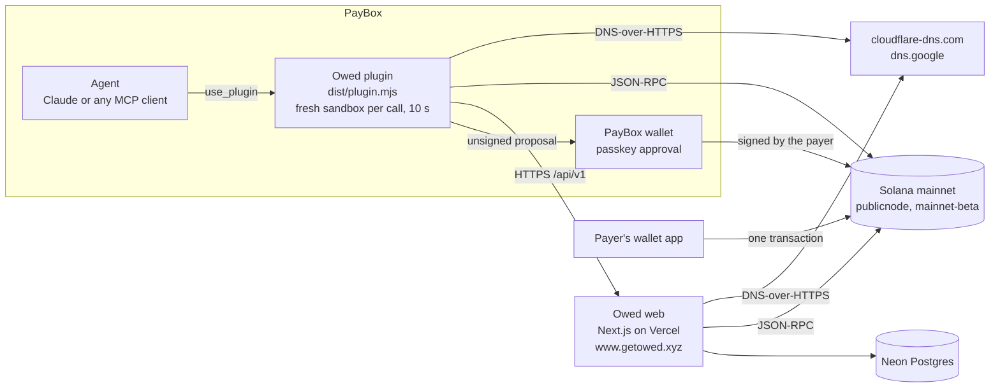

# Architecture

Owed is a PayBox plugin plus a small web service. The plugin is what an agent calls; the web service stores requests, serves the pages people pay from, and checks Solana for payments. Neither one holds money: every payment is a single Solana transaction from the payer's wallet to the recipient.

## The plugin (`plugin/`)

- A TypeScript MCP server over stdio, built from the PayBox plugin starter v1.0.2 and bundled with esbuild to one ESM file, `plugin/dist/plugin.mjs`. Two builds must be byte-identical (`pnpm test`), so nothing reads the clock or randomness at module load.
- PayBox starts a fresh process for every call and gives it 10 seconds. There is no network at startup or during tool discovery. During a call it may reach only the hosts configured in the portal, over HTTPS: the Owed host, two Solana RPC hosts and two DNS-over-HTTPS hosts. There are no secrets: the only variable is `OWED_BASE_URL`, which isn't secret.
- Budgets inside the 10 s: the Owed API gets 4 s per call; Solana reads get 5.5 s, with 3 s per RPC host before falling through to the next; DNS gets 2.5 s per resolver. `pay_link` runs its DNS check alongside the balance check.
- Eleven tools: `ask_for_money`, `check_payments`, `pay_link`, `verify_payee`, `split_bill`, `create_invoice`, `who_owes_me`, `write_reminder`, `ask_every_month`, `cancel_request`, `match_payments` (0012: payments without the reference, matched by the recipient). Tools that move money return a PayBox proposal (`io.paybox/transactionProposal`). The plugin never signs; the user approves in PayBox with a passkey.
- If the Owed API is unreachable, `ask_for_money` still returns a working Solana Pay link (shown on the stateless `/p` page), and `check_payments` checks raw Solana Pay links directly on chain.

## The web service (`web/`)

- Next.js 16 on Vercel, Node runtime for every route. JSON API at `/api/v1`: create and read requests, groups and invoices; batch status (`POST /status`, up to 20 ids); status for a raw Solana Pay link (`POST /status-raw`); stats; a payment matched by the recipient (`POST /requests/<id>/match`, signed, re-verified on chain), the rest of an underpaid request (`POST /requests/<id>/rest`) and what is already counted (`POST /attributed`). Errors are always `{error:{code,message}}`.
- Pages: `/r/<id>` (pay page: QR, wallet button, live status, receipt), `/g/<id>` (split board), `/i/<id>` (printable invoice), `/p?u=<solana: URL>` (stateless page), `/proof`, the landing page and `llms.txt`.
- Storage: Neon Postgres, reached over its SQL-over-HTTP endpoint. Production and previews use separate databases, so previews and smoke runs never write production rows. Schema changes are numbered files in `web/db/migrations/`, applied with `web/scripts/migrate.sh`.
- Requester text (names, "for", notes, invoice lines) is cleaned on the way in: links and invisible characters stripped, double quotes replaced, length capped. Pages show it in quotes, labelled as written by the requester, and isolated for right-to-left scripts. A brand word in the text, or in a verified domain, adds a caution banner. Creation is rate-limited per recipient and globally.

## A request's life

1. **Create.** The server picks a random 32-byte reference and derives the request id from the terms: the last 12 base58 characters of `sha256("owed-request:v1", recipient, asset, atomic amount, reference)` (`web/lib/ids.ts`, `plugin/src/request-id.ts`). The Solana Pay URL carries the recipient, amount, USDC mint (for USDC), the reference and the memo `owed:<id>`. `ask_for_money` refuses a hosted link whose id doesn't hash its terms.
2. **Pay.** A wallet scans the QR or opens the `solana:` link. Or `pay_link` resolves the link, checks the request is open and the sender can cover the amount plus about 0.003 SOL for fees, and builds one legacy transaction: the recipient's USDC account if it's missing (created idempotently), the memo, and `transferChecked` (USDC) or a system transfer (SOL), with the reference as a read-only key. The size limit is 1,232 bytes.
3. **Check.** A request is paid only by one confirmed, successful transaction that carries its reference and credits the recipient with at least the amount. For USDC that's the net change across the recipient's USDC accounts; for SOL it's lamports. Less is underpaid; credits to anyone else, other mints and failed transactions are ignored. Reads accept version-1 transactions, which mainnet carries. Because a reference is public, the check reads the reference's whole history, drops failed transactions and reads oldest first. A transaction that carries several requests' references settles only one of them. The server writes "paid" once; a unique signature index stops one transaction from settling two requests. The plugin applies the same rules when it checks a raw link directly.

## What each part guarantees

- **Non-custodial.** The payer's own wallet sends the money to the recipient in one transaction. Owed has no wallet and adds no fee instruction.
- **The id commits to the payment (Solana Pay rail).** `pay_link` recomputes the id from what `GET /api/v1/requests/<id>` returns, and refuses unless it matches and the server's Solana Pay URL pays exactly those terms. So the server can't change who gets paid or how much behind a link that was already shared: different terms would need a different id. Older random 10-character ids stay readable, but `pay_link` refuses them.
- **x402 rail.** Every request also has an x402 endpoint at `/x/<id>`. With `rail: "x402"`, your agent checks the id and the live x402 challenge against the request before it proposes the payment. PayBox fetches the challenge again when it pays, so "the server can't change who gets paid" is a Solana Pay guarantee only. The first x402 settle on mainnet was request `FeJG9SuofqWU`, 0.01 USDC through PayBox `pay_x402`, with the facilitator as fee payer (docs/FACTS.md).
- **Verified payee.** A requester proves a domain with a DNS TXT record `_owed.<domain>` → `owed-pay=<wallet>` (one record per wallet).
  - The plugin reads that record itself over DNS-over-HTTPS (cloudflare-dns.com, then dns.google). It reports DNSSEC from the resolver's AD flag and warns on internationalized names, mixed scripts, lookalike and digit-for-letter spellings, brand words in the name (each brand's own domains excepted), and names placed in front of another domain.
  - `pay_link` refuses a request whose domain doesn't list its wallet. If DNS can't be read, it refuses unless the user explicitly passes `allow_unverified`, and even then a domain that answers "no" is never paid.
  - The server re-checks the record when a request is created, within a shorter budget than the plugin's API timeout, and stores the domain for display only. The plugin never trusts that copy.
  - "Verified" means the domain lists the wallet. It says who controls the domain, not that the request is fair.
- **Local-currency asks lock USDC, not a promise.** `ask_for_money`, `split_bill` and `create_invoice` take `currency` (an ISO 4217 code from a list of 38, never USD). The server, not the plugin, fetches the rate, so the plugin's hosts don't change (`web/lib/fx.ts`):
  - Rate = Coinbase's USD table (currency per USD ÷ USDC per USD, one response), cross-checked against open.er-api.com's daily USD table. Both up and more than 2% apart: no rate, 503. One up: its rate, named in `rate_source`; open.er-api.com only while under 26 h old. Coinbase's own USDC table isn't used: for some currencies it is a local crypto price (USDC→INR was 6.8% above the rupee's mid-market rate on 2026-10-17).
  - USDC = amount ÷ rate, rounded **up** to 6 decimals, exact bigint arithmetic in `fiat.ts` (one file, copied byte for byte to `plugin/src/` and `web/lib/`). Splits are planned in the currency's minor units, then each share is locked at one rate; invoice lines are priced in the currency and their total is locked.
  - The id still commits to the USDC amount only, so pay_link's tamper check (it recomputes the id from what the server returns) is unchanged. The quote (`fiat`: currency, amount, rate, rate_source, quoted_at) is display only, but every reader recomputes it: the creating tool and `pay_link` refuse a quote that doesn't round up to exactly the USDC amount, and pages, `check_payments`, `who_owes_me` and `write_reminder` show only a quote that does, labelled as a quote. A local-currency ask has no offline link (only the server can lock a rate), and `ask_every_month` refuses `currency` (a rate locked today would be wrong next month).
- **Untrusted text stays untrusted.** Requester-written text reaches the payer's agent only as quoted, cleaned text, with a caution line when it mentions a brand.

## Tests

[docs/TESTING.md](TESTING.md) lists every layer with exact commands: plugin and web unit tests on recorded mainnet and DNS answers, Postgres tests on PGlite, contract fixtures that both sides parse, the MCP harness that runs the bundle as PayBox does and decodes every proposed transaction, and smoke checks against production.
